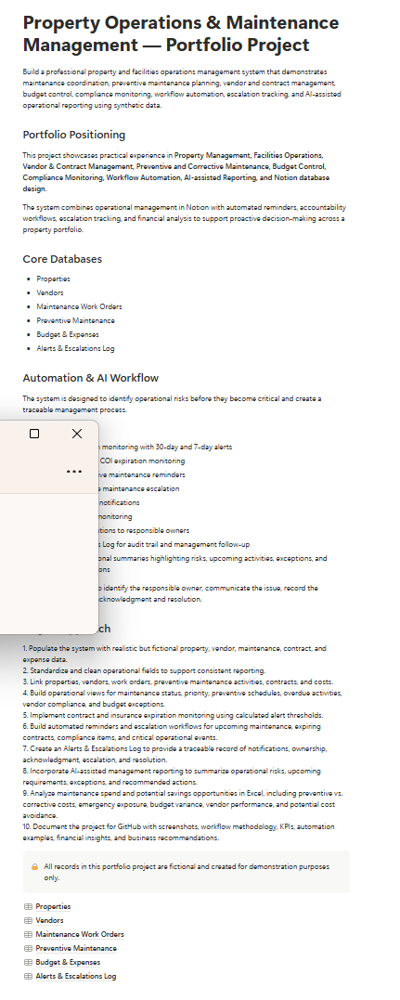
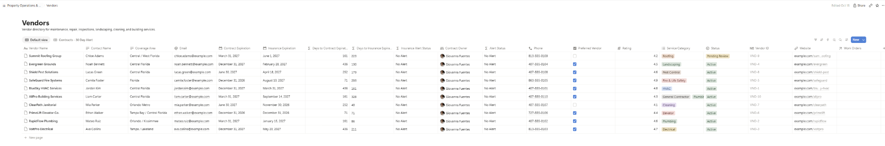
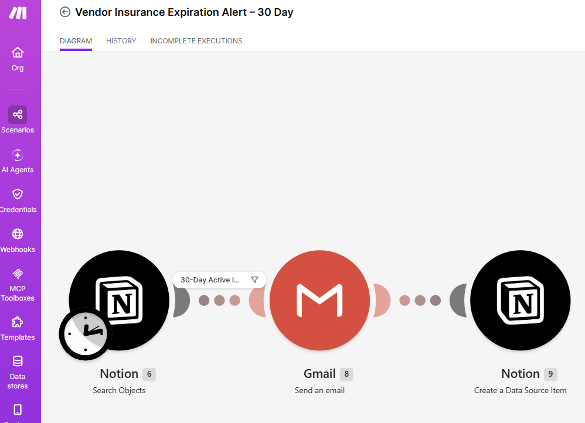
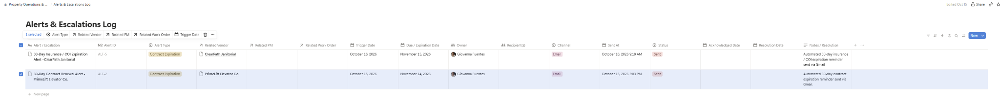
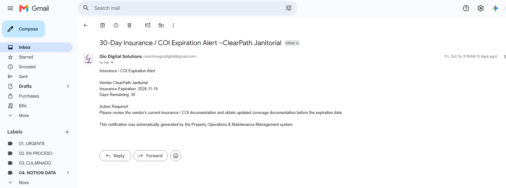
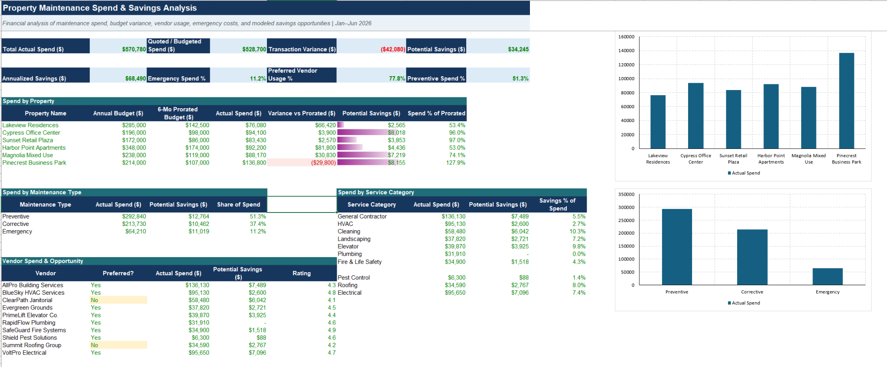
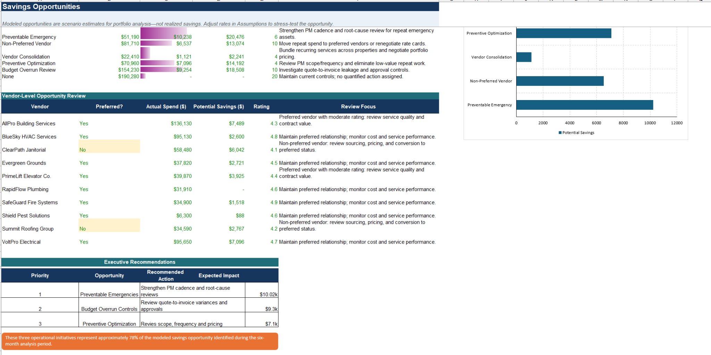

# Property Operations & Maintenance Management

A portfolio project demonstrating how property and facilities operations can be organized, monitored, automated, and financially analyzed across a multi-property portfolio.

The solution combines **Notion** for operational management, **Make** for workflow automation, **Gmail** for automated notifications, and **Excel** for maintenance spend analysis and modeled savings opportunities.

> **Portfolio note:** All properties, vendors, contacts, transactions, and financial data in this project are fictional and were created for demonstration purposes only.

## Executive Snapshot

- **6 fictional properties** managed across a multi-property portfolio
- **10 vendors** tracked for service category, preferred status, contract expiration, insurance/COI expiration, rating, and ownership
- **2 live automation scenarios** built in Make for 30-day contract and insurance/COI alerts
- **54 synthetic maintenance transactions** analyzed from January through June 2026
- **$570,780 actual maintenance spend**
- **$34,245 modeled six-month savings opportunity**
- **$68,490 annualized savings run-rate**
- **78% of modeled savings opportunity concentrated in three operational priorities**

[View the Excel financial analysis workbook](Property_Maintenance_Financial_Analysis.xlsx)

## Business Challenge

Property and facilities teams need to manage vendor compliance, maintenance activity, contract and insurance expirations, operating follow-up, and maintenance spend across multiple locations. When these processes are fragmented, important renewals can be missed, emergency costs can increase, and management has limited visibility into where savings opportunities exist.

This project was designed to create a simple operating system that connects day-to-day property management with proactive alerts and financial decision support.

## Solution Architecture

  
  &nbsp; ➜ &nbsp;
  
  &nbsp; ➜ &nbsp;
  
  &nbsp; ➜ &nbsp;
  
  &nbsp; ➜ &nbsp;
  
  &nbsp; ➜ &nbsp;
  

- **Notion** centralizes properties, vendors, work orders, preventive maintenance, budgets, and alerts.
- **Make** monitors vendor compliance dates and triggers automated workflows.
- **Gmail** delivers operational notifications to responsible stakeholders.
- **Alerts & Escalations Log** creates a traceable record of generated notifications and follow-up.
- **Excel** analyzes maintenance spend, budget variance, vendor usage, emergency exposure, and modeled savings opportunities.

## Tools Used

**Notion · Make · Gmail · Microsoft Excel · AI-assisted workflow design**

Excel capabilities demonstrated include formulas, lookups, conditional formatting, data bars, structured analysis, and executive-ready charts.

## Operational Components

The Notion workspace includes six connected operational databases:

1. Properties
2. Vendors
3. Maintenance Work Orders
4. Preventive Maintenance
5. Budget & Expenses
6. Alerts & Escalations Log

Vendor records include preferred-vendor status, ratings, contract expirations, insurance/COI expirations, ownership, service categories, and alert logic.

## Automated Workflows

### Vendor Contract Expiration — 30 Day Alert

The workflow reviews active vendors, identifies contracts reaching the 30-day renewal threshold, sends an automated email reminder, and creates a traceable entry in the Notion Alerts & Escalations Log.

### Vendor Insurance / COI Expiration — 30 Day Alert

The workflow identifies active vendors approaching insurance or COI expiration, sends a compliance reminder, and records the alert in Notion for audit and follow-up.

The architecture was intentionally designed at the **process level rather than the vendor level**, allowing the same workflow to evaluate multiple vendor records dynamically.

## Financial Analysis

The Excel model analyzes **54 synthetic maintenance transactions from January through June 2026** across six fictional properties.

Key portfolio metrics:

- **Actual maintenance spend:** $570,780
- **Quoted / budgeted spend:** $528,700
- **Unfavorable transaction variance:** $42,080
- **Preferred vendor usage:** 77.8%
- **Preventive maintenance share:** 51.3%
- **Emergency maintenance share:** 11.2%
- **Modeled potential savings:** $34,245
- **Annualized savings run-rate:** $68,490
- **Modeled savings opportunity:** 6.0% of analyzed spend

The annualized figure is a **run-rate scenario, not a guaranteed forecast**. It assumes similar spending patterns continue over a 12-month period.

## Key Findings

### Property-Level Cost Pressure

**Pinecrest Business Park** was the primary cost-pressure location, reaching **127.9% of its six-month prorated maintenance budget** and exceeding plan by approximately **$29.8K**.

### Vendor Management Opportunity

Non-preferred vendor usage represented a measurable sourcing opportunity, particularly within janitorial and roofing services. The analysis also showed that preferred-vendor status alone does not guarantee cost efficiency; scope, pricing, maintenance type, and budget discipline must also be reviewed.

### Concentrated Savings Opportunity

Approximately **78% of modeled savings opportunities** were concentrated in three operational areas:

1. **Preventable Emergencies — $10.2K**
2. **Budget Overrun Controls — $9.3K**
3. **Preventive Maintenance Optimization — $7.1K**

## Executive Recommendations

| Priority | Opportunity | Recommended Action | Modeled Impact |
|---|---|---|---:|
| 1 | Preventable Emergencies | Strengthen preventive-maintenance cadence and root-cause reviews for repeat failures | $10.2K |
| 2 | Budget Overrun Controls | Review quote-to-invoice variances and reinforce approval controls | $9.3K |
| 3 | Preventive Optimization | Review maintenance scope, frequency, and pricing while preserving asset reliability | $7.1K |

These three initiatives represent approximately **78% of the modeled savings opportunity** identified during the six-month analysis period.

## Project Screenshots

### Property Operations Overview

### Vendor Management

### Automated Workflow

### Alerts & Escalations Audit Trail

### Automated Email Notification

### Financial Analysis

### Savings Opportunities

## Repository Contents

- `Property_Maintenance_Financial_Analysis.xlsx` — financial analysis and savings-opportunity model
- `screenshots/` — operational, automation, audit-trail, and financial-analysis evidence
- `README.md` — project documentation and business interpretation

## Skills Demonstrated

**Property Operations · Facilities Management · Vendor Management · Contract & Compliance Monitoring · Workflow Automation · Executive Reporting · Budget Analysis · Financial Analysis · Cost Optimization · Excel · Notion · Make · AI-Assisted Operations**

---

**Created by Giovanna Fuentes**  
Portfolio Project | Property Operations · Executive Operations · Business Analytics
